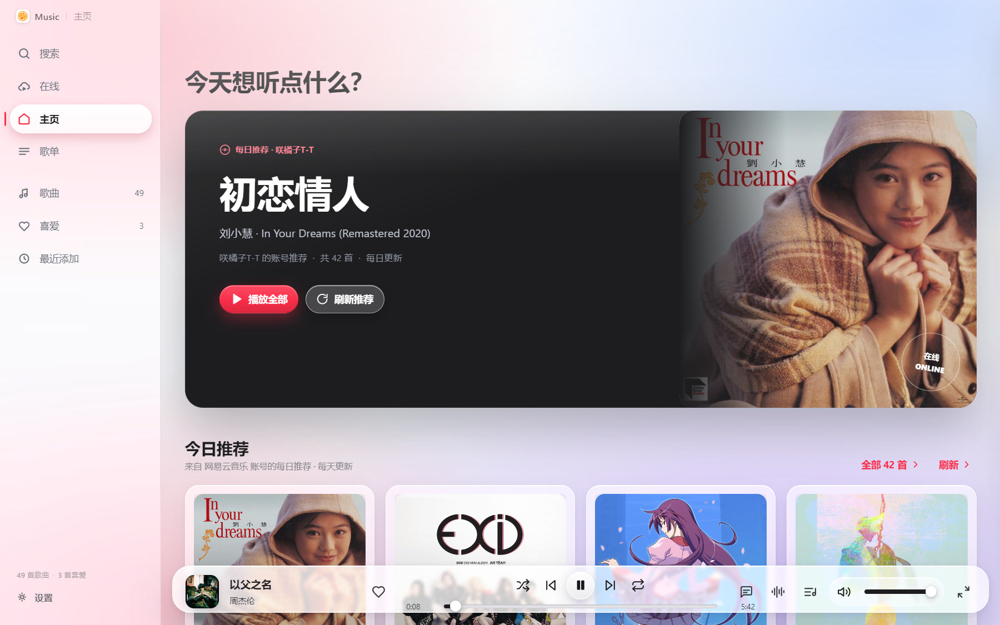
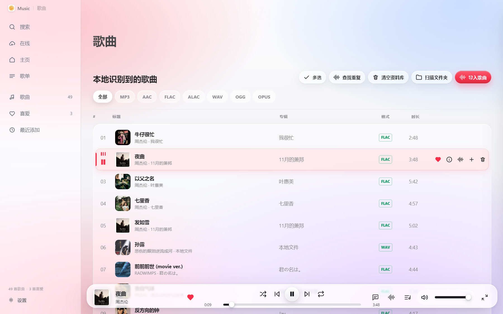
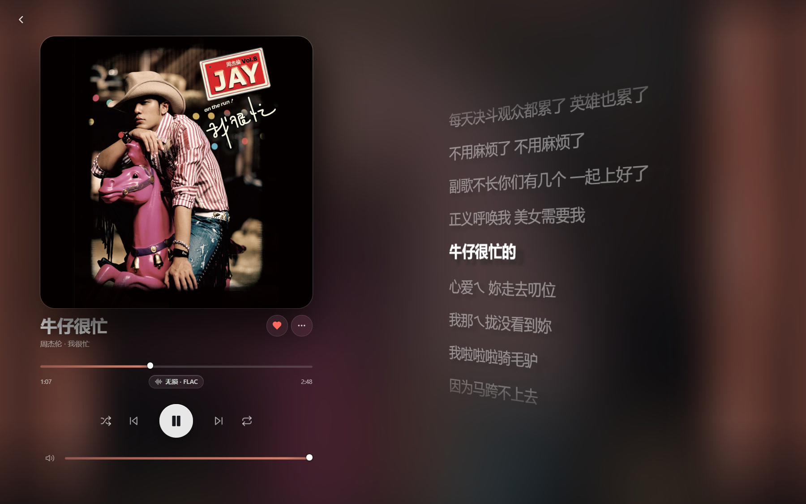
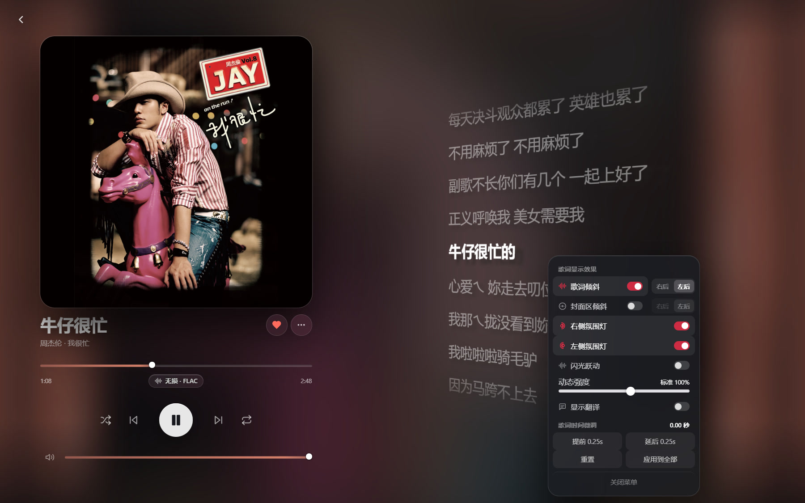
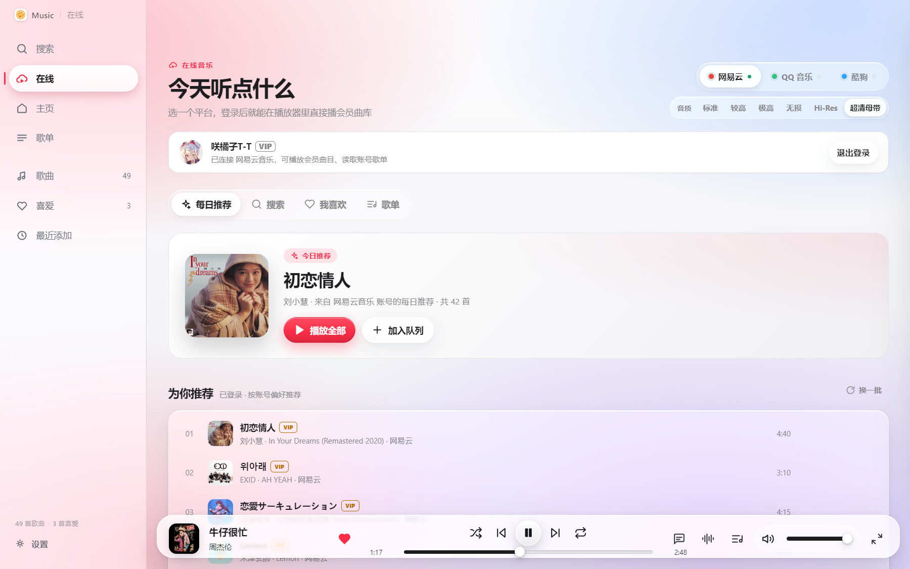
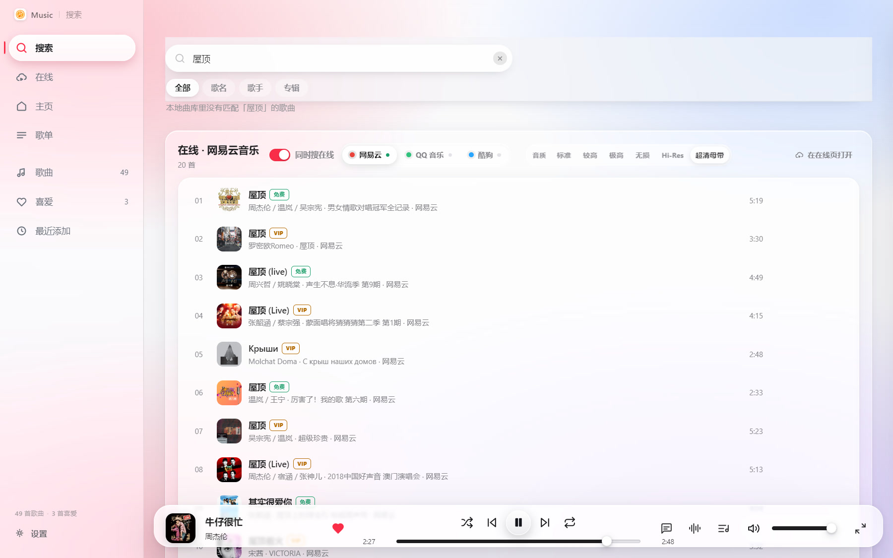

# Orange Music · 本地音乐播放器

一个 Windows 桌面音乐播放器：本地曲库支持 MP3 / FLAC / AAC / WAV / OGG 等常见格式，自动读取标签与封面；同时内置在线音乐页，登录网易云 / QQ 音乐 / 酷狗后可以直接在播放器里在线播放，歌词自动匹配。歌词逐字同步，内置十段均衡器与音量均衡，支持多歌单与资料库自动扫描，还带托盘控制、全局快捷键和可自定义的界面配色。主页每日推荐会按登录账号的口味拉取在线歌曲。  
用 Electron + 原生 HTML / CSS / JavaScript 写成，没有前端框架依赖。



## 更新日志

### v1.6.9

- **首页每日推荐改成真·在线推荐**：主页顶部的推荐大卡和下方推荐歌单不再固定取本地曲库，改为按天拉取在线每日推荐——已登录时按账号口味（网易云 / QQ / 酷狗各自的日推），未登录时用本地收藏与常听歌手拼口味，再不行退到平台热榜；当天结果做快照缓存，重开软件不会变，点「刷新」才重新拉取
- 卡片上带一行来源说明（如「按你的账号口味推荐」），未登录时提示「登录后按账号口味推荐」可一键跳到在线页；纯本地使用、接口失败或返回空时静默回落本地推荐，不弹错、不留白
- 区块头新增「全部 N 首」与刷新按钮，可直接把当天推荐整队加进播放列表
- 在线曲目卡片沿用原有视觉：封面、平台角标、时长、播放与加入队列

### v1.6.8

- **桌面歌词残留上一首**：桌面歌词窗口换歌时只在「新歌有歌词」的情况下重建内容，遇到没有歌词的纯音乐就继续显示上一首的词；现在按曲目 id 判断换歌，一律先清空再渲染，同一首歌拿到空歌词时仍保留原内容不清屏
- **搜索范围残留**：在「歌单 / 收藏 / 全部」某个范围内搜完再清空或按 Esc，范围会一直卡在那里，之后搜什么都只出子集；现在清空关键词时范围复位到「全部」，被范围筛空时的空态行会提示「「全部」里还有 N 首」并允许一键切回
- **Ctrl+F 搜索无响应**：快捷键分发只认了 Ctrl+K，Ctrl+F 在列表页没有任何反应，现在两者等价
- **侧栏「歌曲」没有数量**：渲染逻辑写的节点在界面上不存在，导致侧栏这一项永远是空的后缀，已补上数量

### v1.6.7

- **修搜索页在线结果消失**（重点）：搜索页那段「同时搜在线」面板原来用「开关打开且有词」判断显隐，而开关本身就在面板里 —— 关掉一次后开关跟着消失，且关闭状态被写进本地存储，之后搜索永远只剩本地结果，等于把在线搜索彻底锁死。现在只要有关键词就显示面板，关闭态下留一行带开关的说明让用户随时打开；同时加了一次性旧状态迁移，之前被锁死的用户升级后自动恢复
- **搜索框重做**：输入框从 `input[type=search]` 改成普通文本框（去掉浏览器自带的清除按钮和聚焦描边），自己画了清除按钮、胶囊外框与 7% 墨色柔光环；滚动后才给搜索条铺玻璃底，静止时保持透明
- 搜索范围、平台筛选的 chips 收到 29px 高，与在线页的搜索栏统一成 `44px 胶囊 + 圆形按钮` 一套尺寸
- 本地无命中提示改成占满整行，「查看全部」在有搜索结果时不再重复出现；窄窗口（≤1100px）下在线面板头部改为左对齐换行

### v1.6.6

- **修复均衡器滑杆缩成一团**：全局 `input[type="range"]` 用 `height: 6px !important` 统一了所有滑块高度，把十段 EQ 的竖排滑杆从 96px 强行压成 6px，拇指也被固定成 16px 圆点，整个均衡器挤成一条线、根本拖不动。现在给 `.eq-band` 的滑块单独用更高优先级的选择器恢复成 28×120 的正常竖排滑块，轨道做成「上红下灰」的双色（中间即 0 dB 分界），拇指改成横条并跟随增益值上下移动，正负增益一眼可辨

### v1.6.5

- **代码清理**：删掉 `renderImported()` 死函数（它的目标节点 `#importedTrackList` 早已从界面删除，函数永远提前 return）以及随之而来的孤儿状态 `state.importedIds`（只在导入时 push、删除时 filter，但从没有任何地方读取渲染）
- **EQ 滑杆样式修整**：`.eq-band input[type="range"]` 里 `height: 5px` 和 `width: 100%` 紧跟又被 `height: 96px`、`width: 6px` 覆盖，属于迭代残留的死声明，已合并成一份干净定义

### v1.6.1

- **播放页进度条 / 音量条重做**：以前整条轨道一个颜色，已播和未播分不出来，只有一颗白点滑在上面。现在做成 4px 的凹槽 + 填充：已播段取封面主色（和背后那片氛围雾同一个色源，所以进度条和光永远同色），由深到亮再到末端柔化淡出，末端不再是硬切口；白点收到 11px，只在轨道上，不发光
- **顺手修掉一个老 bug**：`input[type=range]` 那条规则用了 `background` 简写并带 `!important`，把「已播放段渐变」的 `background-image` 一起重置了 —— 底部迷你播放条的进度条其实一直只显示一根光杆轨道。改成 `background-color` 后迷你条也能看到播放进度了
- **歌单只有一份了**（修的就是「网络歌曲加不进歌单」）：以前在线页建歌单写的是 `onlineLib.playlists`，「歌单」页读的是 `state.playlists`，两张表互不相通 —— 在网络页加的歌曲进不了本地歌单，本地建歌单在在线页也选不到，重开软件在线歌单直接消失。现在统一成 `state.playlists`，老数据启动时自动搬过来
- **重启丢歌单里的网络歌曲**：启动时有一段「清理失效曲目 id」的逻辑，那时在线曲目元数据还没恢复，歌单里的 `online:` 曲目会被当成脏数据整条删掉。现在先恢复在线曲目再清理，且带 `online:` 前缀的 id 一律保留
- **歌单封面**：改成「最后加进来的那首歌」的封面（原来是前四首拼四宫格，两首歌时并排两个方块很难看）；编辑弹窗里仍可自己上传图片
- 歌单详情里本地文件不再被标成「免费 · 网易云」，改成显示 `WAV / MP3 · 本地文件`，收藏按钮也走本地收藏
- 在线账号卡片里的 VIP 徽标被 `.ol-account-copy span { display:block }` 撑成整行，看起来像一条空输入框，已改回行内小标签
- 切回「歌单」页时列表不刷新：`showPage` 里判断的是 `page === 'playlists'`，而页面 key 是 `library`，这个条件永远不成立
- 歌单页两个「歌单」标题摞在一起，改成标题带数量（`歌单 3 个`）+ 工具栏只留按钮
- 平台封面统一走 https，不再刷混合内容警告

- **顶部与侧栏重新合并**：顶栏不再是一条横贯全宽的浅色带，改成透明层，只承载品牌、页面名和窗口拖拽；左侧栏玻璃一路做到窗口顶端与底端，顶上是品牌行、底部是「资料库统计 + 设置」。顶部不再有割裂感，侧栏也不再是一个浮在中间的方块
- **滚动收进内容区**：以前是整个窗口滚动，右侧会挂一条从标题栏到窗口底的长滚动条，滚动条滑块毫无用处；现在内容区自己滚、滑块隐藏，标题栏与侧栏始终不动
- 侧栏品牌字号 / 图标 / 分隔线统一到 13px 体系，与导航项左对齐


- **界面改为 iOS 26「液态玻璃」风格**：整页铺一层随主题色变化的柔光壁纸，侧栏 / 顶栏 / 卡片 / 弹层全部改成半透明毛玻璃（blur + saturate + 1px 内高光 + 双层投影）；按钮统一胶囊形，按下回弹；开关换成 iOS 绿；平台与页签改成 iOS 分段控件；滑块手柄常显白色；底部播放条与内容区左对齐，标题栏下方加了淡出层
- **背景彩色光晕可关**：设置 → 主题颜色新增开关，关掉后底层只剩干净的纯色渐变，不再有随主题色流动的柔光
- **顶栏重做**：品牌标记与字号收细，加一条细分隔线和当前页面名（主页 / 设置 / 在线…），底边补一道极淡分割线，原来那条空荡荡的渐变条没了
- **侧栏「设置」入口改成导航胶囊**：不再是独立的小白卡片，配色、圆角、hover 全和上面的导航项一致，进入设置页时有选中态
- **全屏播放页修整**：封面改成真正的正方形（以前被 `max-height` 压成 520×400，上下被裁掉一截），封面改用 1024px 原图渲染，不再发糊；爱心与「更多」按钮统一 38px 同款玻璃圆；播放控制去掉一圈发白的圆形底衬，只在 hover 时亮起，随机 / 循环的开启态改成按钮下方一个小圆点；进度条、音量条、音质徽标一起压暗；左上角返回键从玻璃圆里的箭头换成一个安静的叉号
- **线条与留白**：标题栏底边、侧栏右侧那两条 1px 硬线换成两端渐隐的柔和过渡，侧栏底部加一层柔光 + 一行资料库统计，不再是一大片空色块
- **按钮悬停统一成玻璃**：所有按钮 / 图标按钮 / 标签 / 页签 hover 时都是半透明白 + `backdrop-filter` 模糊 + 内高光描边，能透出背后内容
- 深色模式补全：壁纸、卡片、文字颜色现在会跟着 `body.dark` 一起切换（之前主题类会把深色变量盖回浅色）

- **播放条音质可点**：全屏播放页进度条中间的音质徽标（以前只是写着 `MP3` 的静态标签）现在可以点开选音质，选完就地重新解析直链，并从原进度接着播，不用手动重播
- 档位按平台给，不再是硬凑三档：网易云 **标准 / 较高 / 极高 / 无损 / Hi-Res / 超清母带**，QQ 音乐 **标准 / 高品质 / 无损 / Hi-Res / 臻品母带**，酷狗 标准 / 高品 / 无损；各平台分别记住自己的选择
- 会员档位拿不到时按档位逐级回退（母带 → Hi-Res → 无损 → …），不会像以前那样直接掉到 128k，并提示「当前账号只能拿到 XX」
- 徽标文案改成「容器 + 码率」（`MP3 · 320K`、`无损 · FLAC`），试听片段会额外标注
- 本地曲目不加这个菜单，保持原来的静态标签；未登录的平台会在菜单里直接说明「目前只能拿到标准音质」

### v1.6.0

- **搜索页聚合在线结果**：在搜索页输入关键词，本地结果照旧即时出来，下面追加网易云 / QQ 音乐 / 酷狗的在线匹配结果，可直接播放、喜欢、加入队列或歌单；可切平台、可一键关掉「同时搜在线」，关键词有缓存不重复请求
- **在线音质可选**：标准（128k）/ 高品质（320k）/ 无损（FLAC）三档，在线页与搜索页各有一个选择器且状态互通；网易云按 level 取码流，QQ 音乐按 filename 前缀取，酷狗按账号权限匹配
- 选了无损但账号只给了 MP3 时会明确提示，不会让设置看起来「没生效」
- 「最近播放」现在也能记住在线曲目，重启后可以直接接着播
- 本地搜索无命中时改为一行提示，不再用大块空态挡住下面的在线结果

### v1.5.0

- **新增在线音乐**：网易云音乐 / QQ 音乐 / 酷狗三个音源，点「登录」弹出各站官方登录窗扫码即可，Cookie 存在本地，重启仍有效
- 在线页分四个视图：**每日推荐**（已登录按账号个人化推荐，未登录按本地最近播放与收藏的歌手挑选）、**搜索**、**我喜欢**、**歌单**（自建歌单 + 平台推荐歌单 / 榜单）
- 在线曲目直接在播放器内核里播放：底部播放条、桌面歌词、均衡器、频谱全部照常工作；歌词自动拉取解析，双语自动合并
- 在线收藏与自建歌单持久化到本地，重启后仍可直接播放；收藏页把在线红心拼在本地收藏之后
- 在线页 UI 重新设计：平台切换、账号条、视图标签、推荐大卡片与歌单卡片网格

### v1.3.0

- **新增「桌面歌词」悬浮窗**：独立的置顶透明歌词窗，Apple Music 风格，支持颜色 / 模糊 / 透明 / 圆角 / 字号 / 对齐等外观自定义，逐字点亮 + 轻微漂浮动画，并带随机 / 上一曲 / 播放暂停 / 下一曲 / 循环的悬浮控制栏
- 桌面歌词窗可自由拖动、可拉伸缩放，位置与大小自动记忆，鼠标悬停整窗时显示发光光圈（颜色随歌词色）
- 歌词文字改为轻投影托底，去掉了过重的立体描边，观感更清爽
- 重新整理了「设置」页：合并同类项（播放浮窗 + 左侧功能栏 → 界面背景；窗口与启动 + 启动与导入 → 启动与窗口），并在长分区内加子分组标签，查找更方便
- 修复桌面歌词「背景颜色」无法恢复到自动推导的问题

## 功能

**音乐库**

- 扫描文件夹或选择文件导入，自动识别常见音频格式
- 自动读取标签：标题 / 歌手 / 专辑 / 封面 / 内嵌歌词
- 关闭软件后资料库会保留，下次启动自动恢复（原文件不在原位置时会自动跳过）
- 支持手动刷新：同一文件夹只导入新歌，重复文件按路径去重
- 「只导入歌曲」：自动跳过音效、提示音、语音等非歌曲音频（可按最短时长调整）
- 歌曲详情：格式 / 时长 / 文件大小 / 平均码率 / 采样率 / 声道 / 位深 / 文件位置，可一键定位到文件夹
- 编辑歌曲信息（标题 / 歌手 / 专辑 / 封面，只改资料库不改原文件）
- 查找重复歌曲，一键清理
- 多选 + 全选：批量添加到歌单、批量移除



**播放**

- 播放 / 暂停、上一首 / 下一首、随机、列表循环 / 单曲循环
- 记忆播放进度，再次打开继续上次位置
- 淡入淡出（时长可调）、播放速度 0.5×–2×（保持音高）
- 睡眠定时器：15 / 30 / 45 / 60 / 90 分钟或「播完本曲」
- 音量均衡（ReplayGain）与十段均衡器（31Hz–16kHz，含流行 / 摇滚 / 古典 / 人声 / 低音 / 高音 / 爵士 / 电子预设）

**歌词**

- 支持歌曲内嵌歌词（MP3 的 USLT / SYLT / TXXX，FLAC、OGG 的 LYRICS 注释，M4A 的 ©lyr）与同名 `.lrc`
- 歌词文件支持 UTF-8 / UTF-16 / GBK 编码，文件名可带 `01.` 之类的序号前缀
- 逐字点亮效果，带轻微漂浮动画
- 右键歌词可按 **0.25 秒** 微调，**按歌曲独立记忆**
- 播放中可以自由上下翻歌词，不会被打断，右下角可一键「回到当前」





**在线音乐**

- 三个音源：网易云音乐 / QQ 音乐 / 酷狗，各自独立登录，登录窗内扫码或快捷登录
- 每日推荐：登录后使用该账号的个性化推荐；未登录时按本地最近播放与收藏的歌手去平台搜索，不向平台暴露个人偏好
- 搜索三家曲库，列表带 VIP / 免费标识、音质与封面，可加入播放队列或自建歌单
- 「我喜欢」：平台红心与本地收藏合并去重；未登录也可用（只存本地）
- 平台歌单 / 榜单可以查看曲目并整张导入成自己的歌单
- **全局搜索**：搜索页输入即出本地结果，同时给出三个平台的在线匹配，可直接播放
- **音质可选**：标准 / 高品质 / 无损，在线页与搜索页共用同一份设置
- 在线收藏、自建歌单与播放历史持久化到本地（`orange-online-lib`）

> QQ 音乐与酷狗的播放权限绑定登录态，未登录时只能拿到试听片段或直接失败；网易云未登录可完整播放免费曲目。



**外观与系统**

- 浅色主题色：默认白 / 蜜桃 / 薄荷 / 天青 / 藕荷 / 柠檬 / 樱花
- 播放浮窗（底部播放条）与左侧功能栏可各自选择 模糊 / 亚克力 / 半透明 / 高斯模糊，并调节模糊与透明程度
- **桌面歌词悬浮窗**：独立置顶的透明歌词窗，Apple Music 风格，支持颜色 / 模糊 / 透明 / 圆角 / 字号 / 对齐自定义，逐字点亮 + 漂浮动画，带悬浮播放控制栏，可拖动与缩放
- 歌词界面配色可跟随封面、深色或浅色
- 最小化到托盘、关闭时最小化到托盘、开机自启，托盘菜单可控制播放
- 支持键盘媒体键；快捷键可在设置里点一下重新绑定



## 下载与使用

免安装便携版：

1. 在 [Releases](../../releases) 下载 `Orange-Music-Setup-x.x.x.exe`（或者解压便携包）
2. 双击 `Orange Music.exe` 启动
3. 进入「歌曲」页 → 「扫描文件夹」选择你的音乐目录

> 首次使用建议在「设置 → 自动扫描」里添加常用音乐文件夹并开启「启动时自动扫描」，  
> 以后打开软件会自动把新歌加进来。

## 从源码运行 / 构建

环境要求：Node.js 18+（推荐 20+）、Windows 10/11

```bash
# 安装依赖（国内可加 --registry=https://registry.npmmirror.com）
npm install

# 直接运行
npm start

# 打包成安装程序（输出到 release/）
npm run dist
```

## 快捷键

在「设置 → 快捷键」里点任意一行即可重新绑定。

| 功能          | 默认按键                    |
| ----------- | ----------------------- |
| 播放 / 暂停     | `空格`                    |
| 快退 / 快进 5 秒 | `←` / `→`               |
| 音量减小 / 增大   | `↓` / `↑`               |
| 上一首 / 下一首   | `Ctrl + ←` / `Ctrl + →` |
| 静音          | `M`                     |
| 喜爱当前歌曲      | `F`                     |
| 打开 / 关闭歌词界面 | `L`                     |
| 播放队列        | `Q`                     |
| 随机播放        | `S`                     |
| 切换循环模式      | `R`                     |
| 搜索          | `Ctrl + K`              |
| 关闭弹层 / 返回   | `Esc`                   |

其他操作：双击顶部标题栏可最大化 / 还原，拖动标题栏可移动窗口；歌词界面点右键可微调歌词时间。

## 支持的音频格式

| 情况                         | 格式                                             |
| -------------------------- | ---------------------------------------------- |
| 直接播放                       | MP3、FLAC、AAC / M4A、WAV、OGG、Opus、AIFF           |
| 自动转码播放（内置 FFmpeg，本机完成、不联网） | ALAC、WMA、APE 等系统不支持的编码                         |
| 无法播放                       | 网易云 `.ncm`、QQ 音乐 `.qmc/.mflac`、酷狗 `.kgm` 等加密文件 |

## 目录结构

```
.
├── main.js                # 主进程：窗口、IPC、托盘、文件扫描、ffmpeg 转码
├── preload.js             # 渲染进程与主进程之间的安全桥接
├── renderer/
│   ├── index.html         # 界面结构
│   ├── styles.css         # 全部样式与主题
│   ├── app.js             # 界面逻辑：播放、资料库、歌词、设置
│   ├── online.js          # 在线音乐页逻辑与本地持久化
│   ├── tags.js            # 音频标签 / 歌词解析（主进程与渲染进程共用）
│   ├── desktop-lyrics.html # 桌面歌词悬浮窗（独立透明置顶窗）
│   └── assets/            # 图标与默认封面
├── online/                # 在线音乐（主进程）
│   ├── index.js           # 登录窗、Cookie 持久化、IPC、每日推荐编排
│   ├── net.js             # HTTP / weapi 加密 / 酷狗签名等底层
│   ├── netease.js         # 网易云音源
│   ├── qq.js              # QQ 音乐音源
│   └── kugou.js           # 酷狗音源
├── assets/                # 应用图标（打包用）
├── docs/
│   ├── 使用说明.txt
│   └── screenshots/
└── package.json
```

## 常见问题

**导入后列表是空的？**  
先确认文件是普通音频（MP3 / FLAC / WAV / M4A 等），加密音乐文件无法播放；  
另外「只导入歌曲」会跳过时长过短、没有标签的音效文件，可在设置里关闭。

**歌词显示不出来？**  
点歌曲行的 ⓘ 打开歌曲信息，可以「导入歌词」或「粘贴歌词」；  
也可以把同名的 `.lrc` 放在歌曲旁边，播放时会自动读取。

**歌词对不上时间？**  
在歌词界面点右键，用「歌词提前 / 延后 0.25 秒」微调，只对这首歌生效并自动记住。

**重启后歌曲不见了？**  
资料库记录的是文件路径，如果音乐被移动或删除了就会跳过；重新扫描一次即可。

## 第三方许可

- [Electron](https://github.com/electron/electron)（MIT）
- [FFmpeg](https://ffmpeg.org/)（通过 `@ffmpeg-installer/ffmpeg` 分发，遵循其自身许可证，LGPL / GPL）

本项目的自有代码以 MIT 许可证发布，详见 [LICENSE](LICENSE)。
