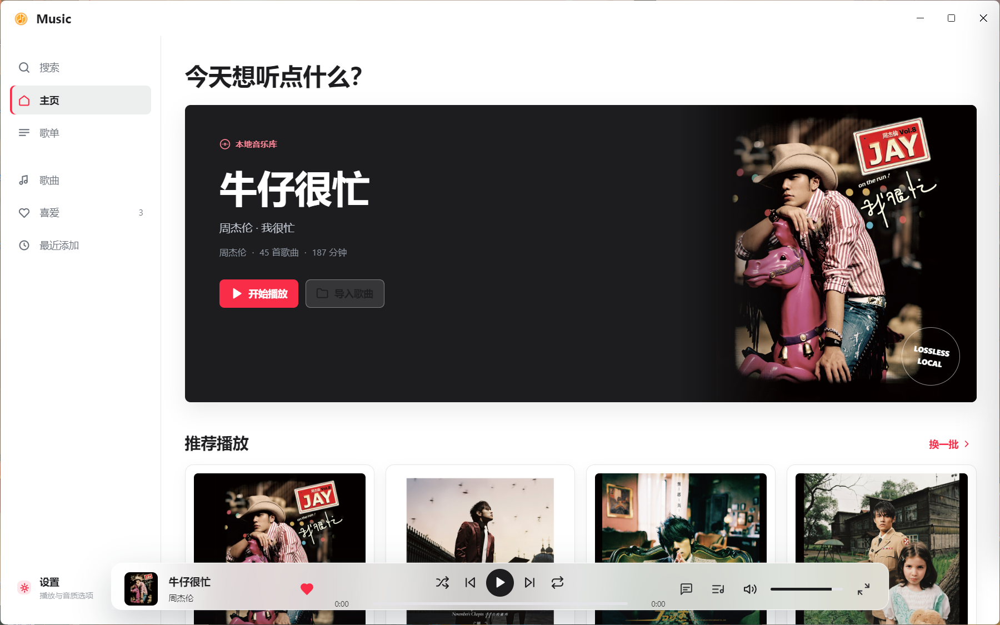
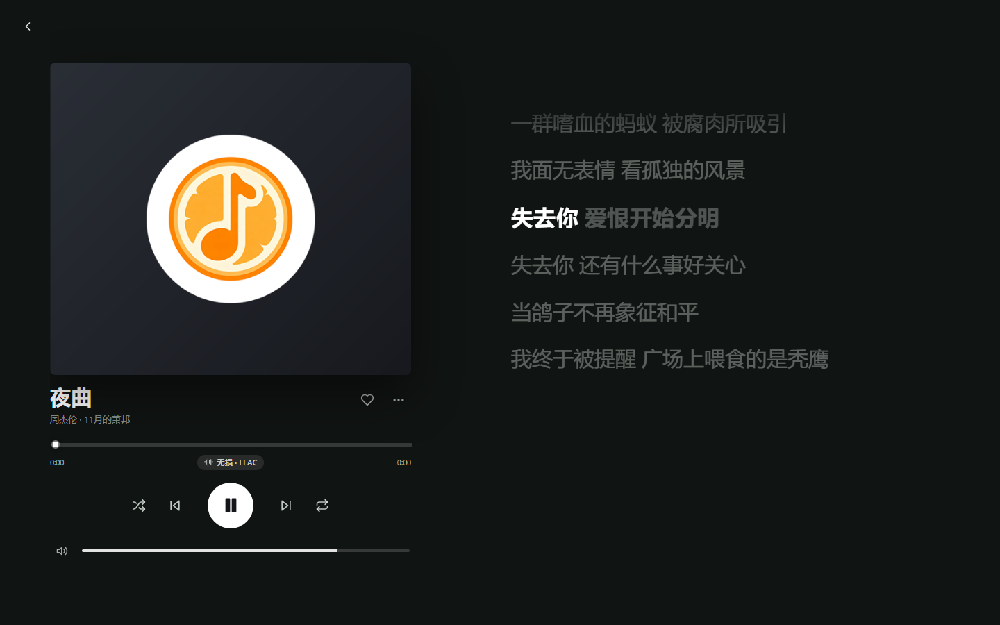
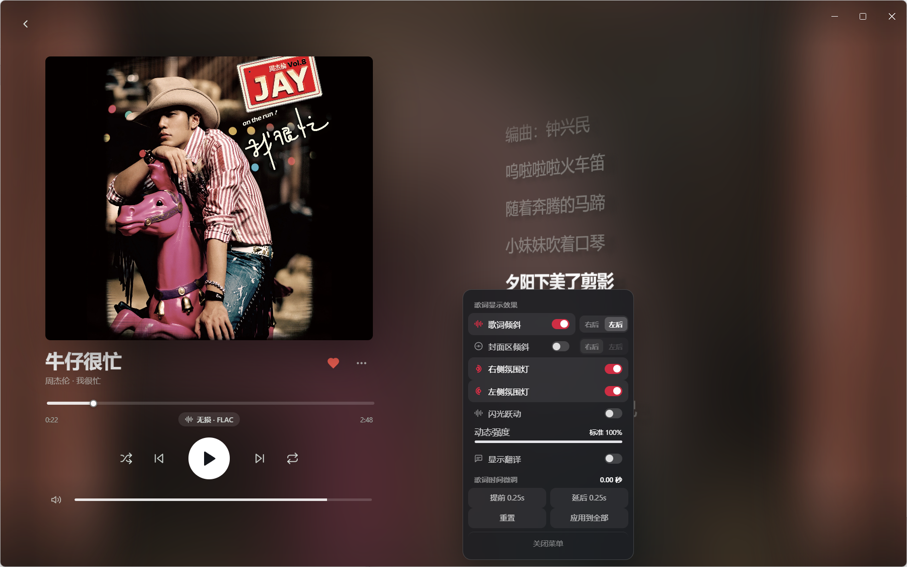
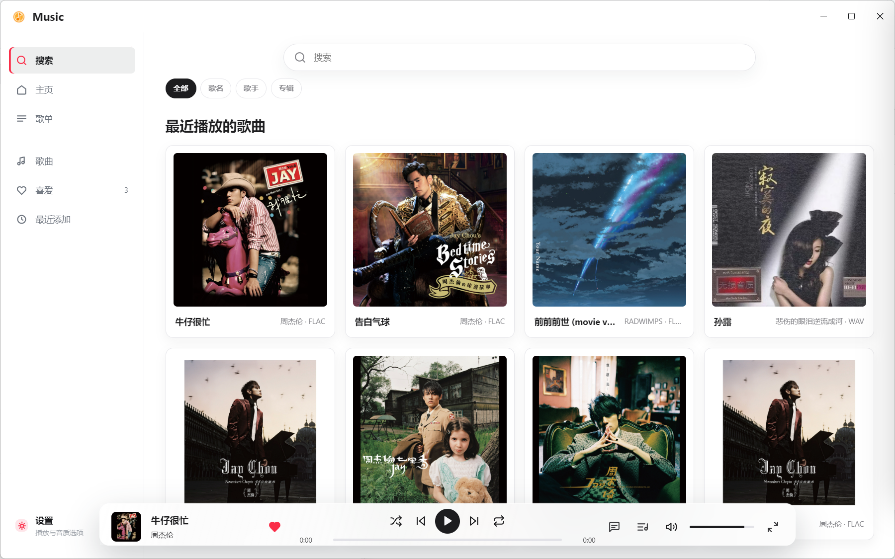

# Orange Music · 本地音乐播放器

[](https://github.com/xiaojuzhi/Orange-Music/releases)
[](LICENSE)
[](https://github.com/xiaojuzhi/Orange-Music)

一个 Windows 桌面音乐播放器：本地曲库支持 MP3 / FLAC / AAC / WAV / OGG 等常见格式，自动读取标签与封面；同时内置在线音乐页，登录网易云 / QQ 音乐 / 酷狗后可以直接在播放器里在线播放，歌词自动匹配。歌词逐字同步，内置十段均衡器与音量均衡，支持多歌单与资料库自动扫描，还带托盘控制、全局快捷键和可自定义的界面配色。  
用 Electron + 原生 HTML / CSS / JavaScript 写成，没有前端框架依赖。



## 更新日志

### v1.8.0

- **封面 / 歌名也能进歌词页**：播放条左侧那块原来是死的，只能点右边的歌词按钮。现在封面 + 歌名 + 歌手整块包成一个按钮，点一下直接进全屏歌词，鼠标移上去封面轻微放大、投一层浅影，键盘 Tab 也能选中回车进入
- **播放条的「全屏」名副其实了**：那颗按钮以前其实只是把歌词页铺满窗口，窗口照样带着标题栏和任务栏，跟旁边写着「全屏」的图标对不上。现在点它是真·窗口全屏（和 F11 同一条路径），主界面也能全屏看列表；再点一次或按 Esc / F11 退回窗口，图标同步换成「向内四角」
- **歌词页右上角补回窗口三键**：歌词页是 `fixed; inset: 0` 的全覆盖层，把自绘标题栏整块压在下面，最小化 / 最大化 / 关闭直接就没了，想关窗只能退回主界面。现在歌词页自带一套——顺序跟真窗口一致，全屏在最左，右边依次是 —、□、✕；四颗统一 36×36 圆形、间距 2px、1.7 笔画（全屏 15px，其余 14px，视觉上一般大），悬停浮出淡色圆底、关闭键是极淡红晕，最大化后 □ 自动变「还原」。顺带把原来那颗 46×52、图标只有 9.5px 可见的「第四个 caption 按钮」重做成同样规格，深色歌词用白、浅色歌词自动转黑
- **系统媒体面板终于有封面了**：`MediaImage` 只认 http/https/data/blob，本地封面是 `file://`，Chromium 直接拒收（控制台常驻一条警告）；而页面里把 `file://` 图画到 canvas 再 `toDataURL` 会被判跨源、抛 SecurityError 被静默吞掉。于是锁屏、音量弹窗、耳机线控面板里一直是空白。现在封面交给主进程用 `nativeImage` 读取、居中裁方、压到 256×256 再以 data URL 下发，整条链路一次通
- **播放失败不再无声无息**：文件被移走、磁盘上被删、格式不被支持时，`<audio>` 只会默默扔一个 error 事件，以前没人接——用户看到的就是「点了播放，进度条不动、没声音、也不提示」。现在会明确提示是哪首歌失败，连播时自动跳过；连跳 3 首就停手并说明原因，避免整个文件夹被移走时一首首刷屏
- **页面加上 CSP**：主窗口之前完全没有内容安全策略，Electron 启动就报一条安全警告。现在按 `file://` 加载的实际需要显式放行同目录脚本 / 样式 / 媒体，`img` 与 `media` 允许 http(s)（在线封面、在线音频），`object-src 'none'`、`base-uri 'self'`，没有任何 inline 脚本
- **桌面歌词按钮会亮了**：以前开与关都没有任何视觉反馈，按钮永远灰着，用户不知道那块置顶浮窗到底开没开。现在开着时按钮变主色 + 淡底，提示文字也换成「关闭桌面歌词」，从浮窗那边点 ✕ 关掉后主界面同步熄灭
- 修掉一处版本号漂移：LRCLIB 请求头里写死的 `OrangeMusic/1.7.2` 改成读 `app.getVersion()`，以后升版本不会再说错
- 清理 7 个再也没被引用的图标定义和 1 个未使用变量（`lastDesktopLyricsPush`）

### v1.7.1

- **耳机校正（AutoEq）**：均衡器里新增「耳机校正」，收录 AutoEq 全量结果 —— **2316 款耳机**（724 款头戴 + 1592 款入耳，228 个品牌），带搜索框，输 `hd650`、`airpods pro`、`1000xm5` 都能直接命中（忽略空格、连字符、大小写）。选中后直接把 AutoEq 的 `FixedBandEQ` 曲线写进现有十段增益 —— 频点 31Hz–16kHz 与播放器的 `EQ_BANDS` 完全一致，不需要改音频链，只多接了一个预增益节点。曲线自带的 Preamp 会同步生效，避免校正后低频抬升处削波。校正状态下十段滤波器切成 AutoEq 计算所用的 `PK` / `Q=1.41`（默认预设仍是原来的 shelving），结果与原版一致。选完还能继续拖滑块微调，按钮下方会标注「已在曲线上手动微调」；切回内置预设时校正自动撤销。列表分批渲染，首屏头戴 / 入耳各 60 条，滚到底自动续，两千多条也不卡
- **Windows 系统媒体控制（SMTC）**：接入 `navigator.mediaSession`，锁屏界面、音量弹窗、耳机线控和键盘媒体键现在都能看到封面、歌名、歌手与进度条，并可直接控制播放 / 暂停 / 上一首 / 下一首 / 快进快退。此前系统里只有一条 `index.html` 的空记录（没有封面、没有歌手，窗口失焦时按键也没反应）。封面会转成 256×256 的 data URL 随元数据下发，不依赖系统去读本地路径；媒体键与 SMTC 回调可能同时到达，切歌做了 350ms 去重，一次按键只跳一首
- 均衡器滑杆步进从 1dB 改成 **0.5dB**，校正曲线取整后滑块位置和实际增益一致（不会出现「显示 +3、实际 +2.6」）
- **专辑 / 艺术家视图**：资料库页顶部多了「歌单 / 专辑 / 艺术家」切换。以前整个曲库只有一张平铺的歌曲表，几千首歌想「听整张专辑」只能靠搜。现在按标签自动分组：专辑按「专辑名 + 歌手」区分（同名专辑不同歌手是两张），曲目按文件名 / 标题开头的序号排；艺术家页显示每人名下的专辑数与曲目数。点卡片进详情页，版式与歌单详情一致，「播放全部 / 随机播放」直接把这一组灌进播放队列；专辑详情里把重复的「专辑」列收掉了
- **在线补词（LRCLIB）**：本地歌既没有内嵌歌词、同目录也没有同名 `.lrc` 时，按歌名 + 歌手 + 时长去 LRCLIB（300 万首，免费无 key）查一次，命中就用它的同步歌词。请求在主进程发，绕开页面 CSP，6 秒超时；候选里按「歌名 / 歌手是否完全一致 + 时长差是否在 3 秒内」打分，避免同名翻唱、现场版拿错词。每首歌只查一次，可以在设置 → 歌词界面里关掉
- **音频输出设备**：设置 → 播放里可以选择声音从哪块声卡 / 耳机出来，默认「跟随系统默认」会随 Windows 切换设备自动跟过去。音频是从 `AudioContext` 出去的，所以切的是 `audioContext.setSinkId`（只改 `<audio>` 不会有任何变化）；插拔耳机后设备列表会自动刷新，选中的设备消失时回落到系统默认并提示
- **均衡器「我的预设」**：原来只能存一套匿名的「自定义」，现在可以命名保存多套（同名覆盖），下拉里单独分组；支持导出 `.json`（带频率标注与预增益）、导入 `.json`，也能直接吃 EqualizerAPO 的 `Filter: ON PK Fc 105 Hz Gain 4.5 dB` 和 `GraphicEQ:` 参数 —— 按对数频率映射到十段，多个滤波器落在同一段时取平均，不会叠成 +30dB
- **单实例**：加了 `requestSingleInstanceLock`，第二次双击（或双击关联文件）不再开第二个进程，而是把已有窗口还原并置前。以前两个实例会同时播放、同时写同一份配置，退出时后写的那份覆盖前一份，表现就是「改过的设置自己变回去了」
- **迷你播放器小窗**：播放条右侧新增小窗按钮，打开后是一个 360×116 的置顶悬浮窗（透明无边框，实际窗口 384×140，四周留出投影空间）。玻璃质感：暖白半透明 + 内高光边 + 暖色投影，封面 72px、歌名 + 艺人、当前歌词行、可拖动的细进度条，右侧上一首 / 播放 / 下一首。整窗可拖动，位置记在 userData，下次打开回到原处；双击空白处或点右上角箭头回主窗口，悬停才显示关闭按钮。主窗口每 200ms 推一次状态（歌名、歌词、进度、播放态），小窗上的操作回传给主窗口执行，关掉主窗口时小窗一并退出
- **自绘窗口按钮**：右上角最小化 / 最大化 / 关闭改成自绘。系统标题栏 overlay 的关闭键悬停时是整块鲜红且改不了色，现在三颗都是 14px 细线图标，悬停走柔和灰底，关闭键只给极淡红晕；最大化后图标自动换成「还原」，双击标题栏空白处也能最大化 / 还原。窗口改为 `frame:false`，代价是最大化按钮上的 Win11 贴靠布局菜单不再出现（拖到屏幕边缘分屏仍然可用）
- **设置页卡片间距**：设置分区之间原本没有外边距，卡片是贴在一起的。改成纵向 flex + 20px 间距，卡片内边距 22 → 26px，标题与内容间距 18 → 22px，二级分组标题上方的留白也加宽，均衡器三段之间各放 2px
- **播放条图标整套重画**：原来那套笔画 1.67px、元素塞满格子，看着重。改成 1.33px 发丝线稿 + 图形收到 22.8/24，留白拉开。顺手改掉三个会认错的形：桌面歌词从「均衡器竖条」改成「显示器 + 屏内字幕」、队列从「音符 + 两行」改成「圆点 + 三行」、全屏从「斜箭头」改成「四角外扩」（原来那个像窗口最大化）；循环改成两段半弧带反向箭头，不再像刷新。播放 / 暂停 / 上一首 / 下一首仍是实心三角，和线稿混排时重心不飘
- **进度条 / 音量条重做**：原来轨道 6px 粗、带玻璃内阴影，白色实心球一直挂在那儿；音量条外面还套着一层胶囊（描边 + 内边距 + 底色），右边那撮工具挤成一团。现在视觉只有 3px 细轨，已播放段用 `--ink` 半透明（深浅主题自动跟，跟封面取色的暗色条也不打架），手柄静止时隐去、鼠标进到这一行才浮出小球；音量胶囊整个拆掉，只留喇叭 + 一条 88px 的细线。轨道画在 `::-webkit-slider-runnable-track` 上，input 本体撑到 15px，视觉变细但拖拽命中区没缩水
- **修掉手柄的两处错位**：原生 range 的手柄圆心只走「轨道宽 − 手柄宽」这一段，而渐变按整条轨道算百分比，于是小球总比填充段终点偏右半个手柄宽（13% 时差 4px，越靠两端越明显）；另外 9px 的球挂在 3px 的线上会朝下歪。现在填充终点改用 `calc((100% - 9px) * ratio + 4.5px)` 跟手柄圆心严格对齐，手柄补 `margin-top: -3px` 压回线的垂直中线，球也从 11px 收到 9px（原来在 88px 的音量条上像颗大黑豆）
- **封面 / 歌名也能进歌词页**：播放条左侧那块原来是死的，只能点右边的歌词按钮。现在封面 + 歌名 + 歌手整块包成一个按钮，点一下直接进全屏歌词，鼠标移上去封面轻微放大、投一层浅影，键盘 Tab 也能选中回车进入
- **播放条的「全屏」名副其实了**：那颗按钮以前其实只是把歌词页铺满窗口，窗口照样带着标题栏和任务栏，跟旁边写着「全屏」的图标对不上。现在点它是真·窗口全屏（和 F11 同一条路径），主界面也能全屏看列表；再点一次或按 Esc / F11 退回窗口，图标同步换成「向内四角」
- **歌词页右上角补回窗口三键**：歌词页是 `fixed; inset: 0` 的全覆盖层，把自绘标题栏整块压在下面，最小化 / 最大化 / 关闭直接就没了，想关窗只能退回主界面。现在歌词页自带一套——顺序跟真窗口一致，全屏在最左，右边依次是 —、□、✕；尺寸统一 36×36 圆形、间距 2px，四颗图标全是 1.7 笔画（全屏 15px，其余 14px，视觉上一般大），悬停浮出淡色圆底、关闭键是极淡红晕，最大化后 □ 自动变「还原」。深色歌词用白、浅色歌词自动转黑

### v1.7.0

- **人声消除（伴奏模式）**：全屏歌词页「喜爱」左边多了一个话筒开关。打开后把立体声拆成左右两路做相位相减（L−R），人声、贝斯、底鼓这些摆在正中的信号会被抵消，只剩左右不同的乐器，适合跟着唱。150Hz 以下的低频单独补回来，避免一开就变得像手机外放。干湿切换用 20ms 斜坡，不会爆音；单声道音源（L 和 R 完全相同）开启前会检测并拦下，切歌时也会自动关掉，不会莫名静音。状态跟随偏好持久化
- **任务栏显示应用名**：窗口标题之前被主动清空（为了不让页面 title 顶掉自绘标题栏），连带 Windows 任务栏气泡、Alt+Tab 列表里也只剩一个图标没有名字。现在标题固定为 `Orange Music`，页面 title 变化不再影响窗口标题
- **音质提示显示实听参数**：切音质后的提示从营销档位名（「超清母带」）改成真实参数，形如 `音质已切换为 FLAC · 24bit · 96kHz`。主进程在解析直链时顺带用 Range 请求读前 96KB 文件头（FLAC STREAMINFO / MP3 帧头 / MP4 mdhd / WAV fmt），同一档位给到的文件是 16bit/44.1k 还是 24bit/96k 一眼可见；探测失败时自动退回档位名，不影响播放
- **窗口全屏**：新增真正的窗口全屏（`F11`），和以前那个「全屏歌词页」是两回事 —— 后者只是把歌词铺满窗口，标题栏和任务栏还在。播放页右上角加了一颗全屏按钮，全屏后主界面不保留任何悬浮按钮，退回靠 `F11` / `Esc` / 双击顶部边框。全屏状态由主进程事件推送，避免 Windows 上回查 `isFullScreen()` 读到过期值把刚生效的样式抹掉
- **首页每日推荐**：首页主卡片和「推荐播放」区块现在优先展示当前账号的每日推荐，点「查看全部」进每日推荐列表、支持整张歌单连播。没网 / 没登录 / 拉取失败时自动回落到本地曲库推荐，并把标题、右上按钮文案、「全部 N 首」等被在线模块改过的元素还原干净，不会出现「标题写着今日推荐、内容却是本地歌」
- **设置页改成左侧导航分栏**：原来一条长列表往下滚，找某一项得一直滑。现在左侧按「播放与音效 / 外观 / 歌词 / 资料库 / 系统」分组固定导航，右侧只显示对应内容，点哪项跳哪块
- **搜索页重做**：搜索框独立成页内输入框（带搜索图标和一键清空），最近搜索的「查看全部」在有查询词时收起；在线搜索结果可以一键关闭（状态记忆在本地），关掉后只搜本地曲库，页面上留一个「开启在线搜索」的入口
- **歌单详情吸顶条**：歌单大标题滚出视口后，吸顶返回条才补上歌单名和歌曲数量。判定用元素实际位置而不是写死滚动阈值，长描述的歌单也不会提前或延后显示
- **修复歌单封面不显示**：在线页的歌单卡片原来只读第一首歌的封面，用户自己设过封面的歌单反而显示成空封面。现在优先用歌单自身封面，没有再退回第一首歌
- **修复桌面歌词唱错歌**：切到一首没有歌词的歌（纯音乐 / 歌词还没加载完）时，窗口里会一直挂着上一首的歌词。现在按曲目 id 判断换歌，换歌一律重建（没歌词就显示「暂无歌词」），同一首歌内才保留旧歌词躲开加载中的瞬时空白
- 清理死代码 `renderLocalOnlinePlaylists()`

### v1.6.6

- **修复均衡器滑杆缩成一团**：全局 `input[type="range"]` 用 `height: 6px !important` 统一了所有滑块高度，把十段 EQ 的竖排滑杆从 96px 强行压成 6px，拇指也被固定成 16px 圆点，整个均衡器挤成一条线、根本拖不动。现在给 `.eq-band` 的滑块单独用更高优先级的选择器恢复成 28×120 的正常竖排滑块，轨道做成「上红下灰」的双色（中间即 0 dB 分界），拇指改成横条并跟随增益值上下移动，正负增益一眼可辨

### v1.6.5

- **代码清理**：删掉 `renderImported()` 死函数（它的目标节点 `#importedTrackList` 早已从界面删除，函数永远提前 return）以及随之而来的孤儿状态 `state.importedIds`（只在导入时 push、删除时 filter，但从没有任何地方读取渲染）
- **EQ 滑杆样式修整**：`.eq-band input[type="range"]` 里 `height: 5px` 和 `width: 100%` 紧跟又被 `height: 96px`、`width: 6px` 覆盖，属于迭代残留的死声明，已合并成一份干净定义

### v1.6.1

- **播放页进度条 / 音量条重做**：以前整条轨道一个颜色，已播和未播分不出来，只有一颗白点滑在上面。现在做成 4px 的凹槽 + 填充：已播段取封面主色（和背后那片氛围雾同一个色源，所以进度条和光永远同色），由深到亮再到末端柔化淡出，末端不再是硬切口；白点收到 11px，只在轨道上，不发光
- **顺手修掉一个老 bug**：`input[type=range]` 那条规则用了 `background` 简写并带 `!important`，把「已播放段渐变」的 `background-image` 一起重置了 —— 底部迷你播放条的进度条其实一直只显示一根光杆轨道。改成 `background-color` 后迷你条也能看到播放进度了
- **歌单只有一份了**（修的就是「网络歌曲加不进歌单」）：以前在线页建歌单写的是 `onlineLib.playlists`，「歌单」页读的是 `state.playlists`，两张表互不相通 —— 在网络页加的歌曲进不了本地歌单，本地建歌单在在线页也选不到，重开软件在线歌单直接消失。现在统一成 `state.playlists`，老数据启动时自动搬过来
- **重启丢歌单里的网络歌曲**：启动时有一段「清理失效曲目 id」的逻辑，那时在线曲目元数据还没恢复，歌单里的 `online:` 曲目会被当成脏数据整条删掉。现在先恢复在线曲目再清理，且带 `online:` 前缀的 id 一律保留
- **歌单封面**：改成「最后加进来的那首歌」的封面（原来是前四首拼四宫格，两首歌时并排两个方块很难看）；编辑弹窗里仍可自己上传图片
- 歌单详情里本地文件不再被标成「免费 · 网易云」，改成显示 `WAV / MP3 · 本地文件`，收藏按钮也走本地收藏
- 在线账号卡片里的 VIP 徽标被 `.ol-account-copy span { display:block }` 撑成整行，看起来像一条空输入框，已改回行内小标签
- 切回「歌单」页时列表不刷新：`showPage` 里判断的是 `page === 'playlists'`，而页面 key 是 `library`，这个条件永远不成立
- 歌单页两个「歌单」标题摞在一起，改成标题带数量（`歌单 3 个`）+ 工具栏只留按钮
- 平台封面统一走 https，不再刷混合内容警告

- **顶部与侧栏重新合并**：顶栏不再是一条横贯全宽的浅色带，改成透明层，只承载品牌、页面名和窗口拖拽；左侧栏玻璃一路做到窗口顶端与底端，顶上是品牌行、底部是「资料库统计 + 设置」。顶部不再有割裂感，侧栏也不再是一个浮在中间的方块
- **滚动收进内容区**：以前是整个窗口滚动，右侧会挂一条从标题栏到窗口底的长滚动条，滚动条滑块毫无用处；现在内容区自己滚、滑块隐藏，标题栏与侧栏始终不动
- 侧栏品牌字号 / 图标 / 分隔线统一到 13px 体系，与导航项左对齐


- **界面改为 iOS 26「液态玻璃」风格**：整页铺一层随主题色变化的柔光壁纸，侧栏 / 顶栏 / 卡片 / 弹层全部改成半透明毛玻璃（blur + saturate + 1px 内高光 + 双层投影）；按钮统一胶囊形，按下回弹；开关换成 iOS 绿；平台与页签改成 iOS 分段控件；滑块手柄常显白色；底部播放条与内容区左对齐，标题栏下方加了淡出层
- **背景彩色光晕可关**：设置 → 主题颜色新增开关，关掉后底层只剩干净的纯色渐变，不再有随主题色流动的柔光
- **顶栏重做**：品牌标记与字号收细，加一条细分隔线和当前页面名（主页 / 设置 / 在线…），底边补一道极淡分割线，原来那条空荡荡的渐变条没了
- **侧栏「设置」入口改成导航胶囊**：不再是独立的小白卡片，配色、圆角、hover 全和上面的导航项一致，进入设置页时有选中态
- **全屏播放页修整**：封面改成真正的正方形（以前被 `max-height` 压成 520×400，上下被裁掉一截），封面改用 1024px 原图渲染，不再发糊；爱心与「更多」按钮统一 38px 同款玻璃圆；播放控制去掉一圈发白的圆形底衬，只在 hover 时亮起，随机 / 循环的开启态改成按钮下方一个小圆点；进度条、音量条、音质徽标一起压暗；左上角返回键从玻璃圆里的箭头换成一个安静的叉号
- **线条与留白**：标题栏底边、侧栏右侧那两条 1px 硬线换成两端渐隐的柔和过渡，侧栏底部加一层柔光 + 一行资料库统计，不再是一大片空色块
- **按钮悬停统一成玻璃**：所有按钮 / 图标按钮 / 标签 / 页签 hover 时都是半透明白 + `backdrop-filter` 模糊 + 内高光描边，能透出背后内容
- 深色模式补全：壁纸、卡片、文字颜色现在会跟着 `body.dark` 一起切换（之前主题类会把深色变量盖回浅色）

- **播放条音质可点**：全屏播放页进度条中间的音质徽标（以前只是写着 `MP3` 的静态标签）现在可以点开选音质，选完就地重新解析直链，并从原进度接着播，不用手动重播
- 档位按平台给，不再是硬凑三档：网易云 **标准 / 较高 / 极高 / 无损 / Hi-Res / 超清母带**，QQ 音乐 **标准 / 高品质 / 无损 / Hi-Res / 臻品母带**，酷狗 标准 / 高品 / 无损；各平台分别记住自己的选择
- 会员档位拿不到时按档位逐级回退（母带 → Hi-Res → 无损 → …），不会像以前那样直接掉到 128k，并提示「当前账号只能拿到 XX」
- 徽标文案改成「容器 + 码率」（`MP3 · 320K`、`无损 · FLAC`），试听片段会额外标注
- 本地曲目不加这个菜单，保持原来的静态标签；未登录的平台会在菜单里直接说明「目前只能拿到标准音质」

### v1.6.0

- **搜索页聚合在线结果**：在搜索页输入关键词，本地结果照旧即时出来，下面追加网易云 / QQ 音乐 / 酷狗的在线匹配结果，可直接播放、喜欢、加入队列或歌单；可切平台、可一键关掉「同时搜在线」，关键词有缓存不重复请求
- **在线音质可选**：标准（128k）/ 高品质（320k）/ 无损（FLAC）三档，在线页与搜索页各有一个选择器且状态互通；网易云按 level 取码流，QQ 音乐按 filename 前缀取，酷狗按账号权限匹配
- 选了无损但账号只给了 MP3 时会明确提示，不会让设置看起来「没生效」
- 「最近播放」现在也能记住在线曲目，重启后可以直接接着播
- 本地搜索无命中时改为一行提示，不再用大块空态挡住下面的在线结果

### v1.5.0

- **新增在线音乐**：网易云音乐 / QQ 音乐 / 酷狗三个音源，点「登录」弹出各站官方登录窗扫码即可，Cookie 存在本地，重启仍有效
- 在线页分四个视图：**每日推荐**（已登录按账号个人化推荐，未登录按本地最近播放与收藏的歌手挑选）、**搜索**、**我喜欢**、**歌单**（自建歌单 + 平台推荐歌单 / 榜单）
- 在线曲目直接在播放器内核里播放：底部播放条、桌面歌词、均衡器、频谱全部照常工作；歌词自动拉取解析，双语自动合并
- 在线收藏与自建歌单持久化到本地，重启后仍可直接播放；收藏页把在线红心拼在本地收藏之后
- 在线页 UI 重新设计：平台切换、账号条、视图标签、推荐大卡片与歌单卡片网格

### v1.3.0

- **新增「桌面歌词」悬浮窗**：独立的置顶透明歌词窗，Apple Music 风格，支持颜色 / 模糊 / 透明 / 圆角 / 字号 / 对齐等外观自定义，逐字点亮 + 轻微漂浮动画，并带随机 / 上一曲 / 播放暂停 / 下一曲 / 循环的悬浮控制栏
- 桌面歌词窗可自由拖动、可拉伸缩放，位置与大小自动记忆，鼠标悬停整窗时显示发光光圈（颜色随歌词色）
- 歌词文字改为轻投影托底，去掉了过重的立体描边，观感更清爽
- 重新整理了「设置」页：合并同类项（播放浮窗 + 左侧功能栏 → 界面背景；窗口与启动 + 启动与导入 → 启动与窗口），并在长分区内加子分组标签，查找更方便
- 修复桌面歌词「背景颜色」无法恢复到自动推导的问题

## 功能

**音乐库**

- 扫描文件夹或选择文件导入，自动识别常见音频格式
- 自动读取标签：标题 / 歌手 / 专辑 / 封面 / 内嵌歌词
- 关闭软件后资料库会保留，下次启动自动恢复（原文件不在原位置时会自动跳过）
- 支持手动刷新：同一文件夹只导入新歌，重复文件按路径去重
- 「只导入歌曲」：自动跳过音效、提示音、语音等非歌曲音频（可按最短时长调整）
- 歌曲详情：格式 / 时长 / 文件大小 / 平均码率 / 采样率 / 声道 / 位深 / 文件位置，可一键定位到文件夹
- 编辑歌曲信息（标题 / 歌手 / 专辑 / 封面，只改资料库不改原文件）
- 查找重复歌曲，一键清理
- 多选 + 全选：批量添加到歌单、批量移除

**播放**

- 播放 / 暂停、上一首 / 下一首、随机、列表循环 / 单曲循环
- 记忆播放进度，再次打开继续上次位置
- 淡入淡出（时长可调）、播放速度 0.5×–2×（保持音高）
- 睡眠定时器：15 / 30 / 45 / 60 / 90 分钟或「播完本曲」
- 音量均衡（ReplayGain）与十段均衡器（31Hz–16kHz，含流行 / 摇滚 / 古典 / 人声 / 低音 / 高音 / 爵士 / 电子预设）
- **耳机校正**：内置 AutoEq 全量 2316 款耳机的校正曲线（头戴 / 入耳），支持按品牌或型号搜索，选中即写入十段增益并套用预增益，可在此基线上继续微调

**歌词**

- 支持歌曲内嵌歌词（MP3 的 USLT / SYLT / TXXX，FLAC、OGG 的 LYRICS 注释，M4A 的 ©lyr）与同名 `.lrc`
- 歌词文件支持 UTF-8 / UTF-16 / GBK 编码，文件名可带 `01.` 之类的序号前缀
- 逐字点亮效果，带轻微漂浮动画
- 右键歌词可按 **0.25 秒** 微调，**按歌曲独立记忆**
- 播放中可以自由上下翻歌词，不会被打断，右下角可一键「回到当前」





**在线音乐**

- 三个音源：网易云音乐 / QQ 音乐 / 酷狗，各自独立登录，登录窗内扫码或快捷登录
- 每日推荐：登录后使用该账号的个性化推荐；未登录时按本地最近播放与收藏的歌手去平台搜索，不向平台暴露个人偏好
- 搜索三家曲库，列表带 VIP / 免费标识、音质与封面，可加入播放队列或自建歌单
- 「我喜欢」：平台红心与本地收藏合并去重；未登录也可用（只存本地）
- 平台歌单 / 榜单可以查看曲目并整张导入成自己的歌单
- **全局搜索**：搜索页输入即出本地结果，同时给出三个平台的在线匹配，可直接播放
- **音质可选**：标准 / 高品质 / 无损，在线页与搜索页共用同一份设置
- 在线收藏、自建歌单与播放历史持久化到本地（`orange-online-lib`）

> QQ 音乐与酷狗的播放权限绑定登录态，未登录时只能拿到试听片段或直接失败；网易云未登录可完整播放免费曲目。

**外观与系统**

- 浅色主题色：默认白 / 蜜桃 / 薄荷 / 天青 / 藕荷 / 柠檬 / 樱花
- 播放浮窗（底部播放条）与左侧功能栏可各自选择 模糊 / 亚克力 / 半透明 / 高斯模糊，并调节模糊与透明程度
- **桌面歌词悬浮窗**：独立置顶的透明歌词窗，Apple Music 风格，支持颜色 / 模糊 / 透明 / 圆角 / 字号 / 对齐自定义，逐字点亮 + 漂浮动画，带悬浮播放控制栏，可拖动与缩放
- 歌词界面配色可跟随封面、深色或浅色
- 最小化到托盘、关闭时最小化到托盘、开机自启，托盘菜单可控制播放
- 支持键盘媒体键；快捷键可在设置里点一下重新绑定
- **系统媒体控制**：Windows 锁屏、音量弹窗与耳机线控走 SMTC，显示封面 / 歌名 / 歌手 / 进度，可直接控制播放



## 下载与使用

1. 在 [Releases](https://github.com/xiaojuzhi/Orange-Music/releases) 下载最新的 `Orange Music Setup 1.8.0.exe`
2. 双击安装（可以自己选安装目录），装完从开始菜单或桌面图标启动
3. 进入「歌曲」页 → 「扫描文件夹」选择你的音乐目录

> 首次使用建议在「设置 → 自动扫描」里添加常用音乐文件夹并开启「启动时自动扫描」，  
> 以后打开软件会自动把新歌加进来。

## 从源码运行 / 构建

环境要求：Node.js 18+（推荐 20+）、Windows 10/11

```bash
# 安装依赖（国内可加 --registry=https://registry.npmmirror.com）
npm install

# 直接运行
npm start

# 打包成安装程序（输出到 release/）
npm run dist

# 打包 + 装到本机 + 导出源码镜像与 zip（交付流程）
npm run publish:github
```

`publish:github` 的落盘位置默认是项目内的 `publish-out/`；要指到别处，在项目根放一个
`publish.local.json`（已在 `.gitignore` 里）：

```json
{
  "mirrorDir": "D:/dist/Orange-Music-${version}-源码",
  "installerDir": "D:/dist/安装包"
}
```

也可以用环境变量 `ORANGE_MIRROR_DIR` / `ORANGE_INSTALLER_DIR` 覆盖。


## 快捷键

在「设置 → 快捷键」里点任意一行即可重新绑定。

| 功能          | 默认按键                    |
| ----------- | ----------------------- |
| 播放 / 暂停     | `空格`                    |
| 快退 / 快进 5 秒 | `←` / `→`               |
| 音量减小 / 增大   | `↓` / `↑`               |
| 上一首 / 下一首   | `Ctrl + ←` / `Ctrl + →` |
| 静音          | `M`                     |
| 喜爱当前歌曲      | `F`                     |
| 打开 / 关闭歌词界面 | `L`                     |
| 播放队列        | `Q`                     |
| 随机播放        | `S`                     |
| 切换循环模式      | `R`                     |
| 搜索          | `Ctrl + K`              |
| 关闭弹层 / 返回   | `Esc`                   |

其他操作：双击顶部标题栏可最大化 / 还原，拖动标题栏可移动窗口；歌词界面点右键可微调歌词时间。

## 支持的音频格式

| 情况                         | 格式                                             |
| -------------------------- | ---------------------------------------------- |
| 直接播放                       | MP3、FLAC、AAC / M4A、WAV、OGG、Opus、AIFF           |
| 自动转码播放（内置 FFmpeg，本机完成、不联网） | ALAC、WMA、APE 等系统不支持的编码                         |
| 无法播放                       | 网易云 `.ncm`、QQ 音乐 `.qmc/.mflac`、酷狗 `.kgm` 等加密文件 |

## 目录结构

```
.
├── main.js                # 主进程：窗口、IPC、托盘、文件扫描、ffmpeg 转码
├── preload.js             # 渲染进程与主进程之间的安全桥接
├── renderer/
│   ├── index.html         # 界面结构
│   ├── styles.css         # 全部样式与主题
│   ├── app.js             # 界面逻辑：播放、资料库、歌词、设置
│   ├── online.js          # 在线音乐页逻辑与本地持久化
│   ├── tags.js            # 音频标签 / 歌词解析（主进程与渲染进程共用）
│   ├── autoeq.js          # 耳机校正曲线数据（AutoEq，2316 款型号，自动生成，约 370 KB）
│   ├── desktop-lyrics.html # 桌面歌词悬浮窗（独立透明置顶窗）
│   └── assets/            # 图标与默认封面
├── online/                # 在线音乐（主进程）
│   ├── index.js           # 登录窗、Cookie 持久化、IPC、每日推荐编排
│   ├── net.js             # HTTP / weapi 加密 / 酷狗签名等底层
│   ├── netease.js         # 网易云音源
│   ├── qq.js              # QQ 音乐音源
│   └── kugou.js           # 酷狗音源
├── assets/                # 应用图标（打包用）
├── docs/
│   ├── 使用说明.txt
│   └── screenshots/
└── package.json
```

## 常见问题

**导入后列表是空的？**  
先确认文件是普通音频（MP3 / FLAC / WAV / M4A 等），加密音乐文件无法播放；  
另外「只导入歌曲」会跳过时长过短、没有标签的音效文件，可在设置里关闭。

**歌词显示不出来？**  
点歌曲行的 ⓘ 打开歌曲信息，可以「导入歌词」或「粘贴歌词」；  
也可以把同名的 `.lrc` 放在歌曲旁边，播放时会自动读取。

**歌词对不上时间？**  
在歌词界面点右键，用「歌词提前 / 延后 0.25 秒」微调，只对这首歌生效并自动记住。

**重启后歌曲不见了？**  
资料库记录的是文件路径，如果音乐被移动或删除了就会跳过；重新扫描一次即可。

## 第三方许可

- [Electron](https://github.com/electron/electron)（MIT）
- [FFmpeg](https://ffmpeg.org/)（通过 `@ffmpeg-installer/ffmpeg` 分发，遵循其自身许可证，LGPL / GPL）
- [AutoEq](https://github.com/jaakkopasanen/AutoEq)（MIT）：耳机校正曲线的数据来源，量测数据出自 oratory1990 与 crinacle，目标曲线为 Harman over-ear / in-ear 2019。安装包里收录的是 `FixedBandEQ` 结果（10 段固定频点，与播放器的 EQ 频点一致），只保留曲线数据本身，约 370 KB

本项目的自有代码以 MIT 许可证发布，详见 [LICENSE](LICENSE)。
